<div align="center">

  <!-- Retro CRT Animated Terminal Window -->
  <a href="https://github.com/japanchicken898-droid">
    
  </a>

  <br />

  <!-- Dynamic Typing Subtitle SVG -->
  

  <br />

  <!-- Minimal Uniform Flat-Square Badges -->
  <p align="center">
    
    
    
    
    
  </p>

</div>

---

### `// SYSTEM_PROFILE`

```ansi
[IDENTITY]       Deepak Bathirachalam
[ROLE]           2nd Year B.Tech Information Technology Student
[ENVIRONMENT]    macOS • zsh • tmux • Neovim
[INTERESTS]      Competitive Programming • System Architecture • Distributed Systems
[STATUS]         Open to Software Engineering & Systems Internships (Summer 2025/2026)
```

---

### `// COMPETITIVE_PROGRAMMING & HACKATHONS`

```ansi
🏆 1st PLACE WINNER — API Heist @ TechnoVIT (VIT Chennai)
   └─ Outperformed 50+ collegiate engineering teams in a 24-hour high-pressure development sprint.
   └─ Architected a high-throughput API gateway and fault-tolerant microservice cluster under strict latency SLA.

🎯 NATIONAL HACKATHON FINALIST
   └─ Qualified in the top percentile of national engineering hackathons.
   └─ Built resilient distributed system prototypes and defended architectural decisions before industry juries.

⚡ ALGORITHMIC PROBLEM SOLVER
   └─ 500+ problems solved across competitive coding platforms (LeetCode, Codeforces).
   └─ Core focus: Advanced Graph Algorithms (Traversals, Shortest Paths, Flow), Dynamic Programming, and Asymptotic Optimization.
```

---

### `// CORE_ARCHITECTURE & STACK`

```ansi
┌──────────────────────────────────────────────────────────────────────────────┐
│ CORE LANGUAGES       :: Python • Java • TypeScript • C++                     │
│ FOCUS & INTELLIGENCE :: Edge ML • Computer Vision Pipelines • Neural Inference│
│ SYSTEM ARCHITECTURE  :: Agentic Architectures • Microservices • RESTful APIs │
│ INFRASTRUCTURE & OPS :: Docker • Linux Internals • POSIX Tooling • Git CI/CD │
└──────────────────────────────────────────────────────────────────────────────┘
```

- **Distributed Systems & Resilient APIs:** Designing decoupled event-driven services, high-throughput microservices, and idempotent REST endpoints with predictable performance profiles.
- **Edge ML & Vision Pipelines:** Optimizing lightweight computer vision inference on hardware-constrained edge environments with real-time frame streaming and feature classification.
- **Agentic Architectures:** Designing autonomous agent decision loops, multi-tool execution pipelines, and deterministic state transitions.

---

### `// NETWORK & DISPATCH`

```ansi
[LINKEDIN]  https://linkedin.com/in/deepak-bathirachalam-517ba62b7
[GITHUB]    https://github.com/japanchicken898-droid
[EMAIL]     japanchicken898@gmail.com
```

<div align="center">
  <sub>Engineered with precision. Powered by phosphor CRT terminals &amp; continuous iteration.</sub>
</div>
